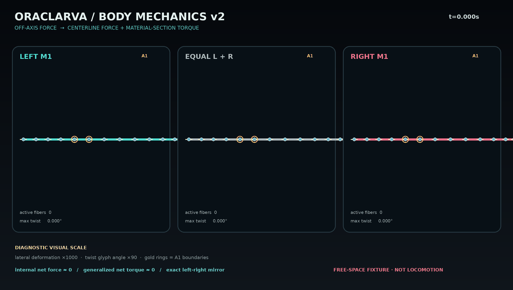

# Oriented body mechanics v2

Body Mechanics v2 keeps the existing named neural and muscle identities but
changes what happens at the body boundary. A muscle endpoint is no longer
represented only by a force folded onto the centerline. Each body station now
has an oriented material cross-section, and every endpoint contributes both a
centerline force and a section torque.



The GIF deliberately magnifies lateral displacement by 1,000 and director
angle by 90. It is a mechanics diagnostic, not a claim about measured L1
deformation amplitude or locomotion.

## Claim boundary

This stage is an engineering-validated free-space mechanics fixture. It is not
an independently validated biological body model and it does not demonstrate
locomotion or steering. With no substrate reaction, an internal muscle can
deform the body but cannot translate its center of mass.

- Normalized attachment coordinates: `ANATOMY_DERIVED`
- Tension, torsion, stiffness, damping, and angular response: `MODEL_FITTED`
- Force unit: model unit, not newton
- Torque unit: model-unit metre, not newton-metre
- Individual L1 CSA, Fmax, torsional inertia, cuticle stiffness, and pressure:
  not measured here

The previous v1 artifact remains frozen and unchanged. This v2 layer is kept
separate until environmental contact can be added and validated without
mistaking an internal force for propulsion.

## State and force mapping

The body has the existing 13 centerline nodes and 13 material sections. The
section tangent follows the centerline, so centerline curvature is the bending
degree of freedom. Each section additionally carries a twist angle around that
tangent. Lateral and dorsal directors are parallel-transported as the
centerline bends, then rotated by the local twist angle.

For an endpoint with normalized axial coordinate `s`, centerline point `c`,
surface point `p`, and line force `F`, v2 uses

```text
r = p - c

node force i     += (1-s) F
node force i+1   += s F
section torque i += (1-s) (r × F)
section torque i+1 += s (r × F)
```

The insertion receives `-F`. Since `F` is parallel to the line between origin
and insertion, the complete internal generalized load obeys

```text
Σ F = 0
Σ ((x_node - x_center) × F_node + τ_section) = 0
```

The second equation is the important v2 change. The v1 centerline projection
preserved net force but discarded the radial moment arm. That made the
centerline forces alone look like a whole-body torque. V2 retains the missing
section torque, so the full internal wrench is balanced.

Twist is integrated from the tangent component of section torque. Neighboring
sections exchange equal-and-opposite fitted torsional torque. This is a reduced
unshearable rod, not a shell: cross-section shear, warping, pressure, and local
cuticle strain are unresolved.

## Checked fixture

The fixture activates the existing named pair
`A1:left:M1:DA1` / `A1:right:M1:DA1` through its mapped motor-neuron source.
It runs three cases for 0.2 seconds:

1. equal bilateral activation;
2. left-only activation;
3. right-only activation.

It also repeats the left case with the left attachment mechanically lesioned.
The lesion occurs after named muscle activation, so upstream activity remains
while endpoint force and section torque disappear.

Checked results:

| Gate | Result |
|---|---:|
| Active/traced load samples, each unilateral case | 199 / 199 |
| Endpoint applications, each unilateral case | 398 |
| Maximum net-force residual | `2.78e-17` model units |
| Maximum centerline-only moment | `7.27e-7` model-unit m |
| Maximum full generalized-torque residual | `4.36e-21` model-unit m |
| Left/right final node mirror error | `0.0 µm` |
| Left/right final twist mirror error | `0.0°` |
| Maximum section twist | about `0.208°` |
| Uniform differential load and twist | exactly zero |
| Attachment-lesion load and twist | exactly zero |

The exact machine-readable values live in
`data/validation/oriented_body_mechanics_v2.json`.

## Reproduce

```bash
python tools/export_oriented_body_mechanics.py --check
python tools/render_oriented_body_mechanics_gif.py
pytest -q tests/test_oriented_body_mechanics.py tests/test_fiber_body.py \
  tests/test_named_fiber_steering.py
```

## What this does not yet solve

- No full shell or continuum finite-element body is claimed.
- No independent pitch/yaw command enters the body.
- No substrate force is included in the v2 fixture.
- No locomotion follows from internal force alone.
- The current attachment atlas remains normalized and anatomy-derived.
- Pressure, anisotropic cuticle mechanics, self-contact, and measured L1
  material parameters remain open.

The next mechanics stage is therefore contact integration: use the balanced
off-axis loads inside the environmental closed loop, report substrate reaction
forces separately, and require any translation or heading change to be
accounted for by those external reactions.
